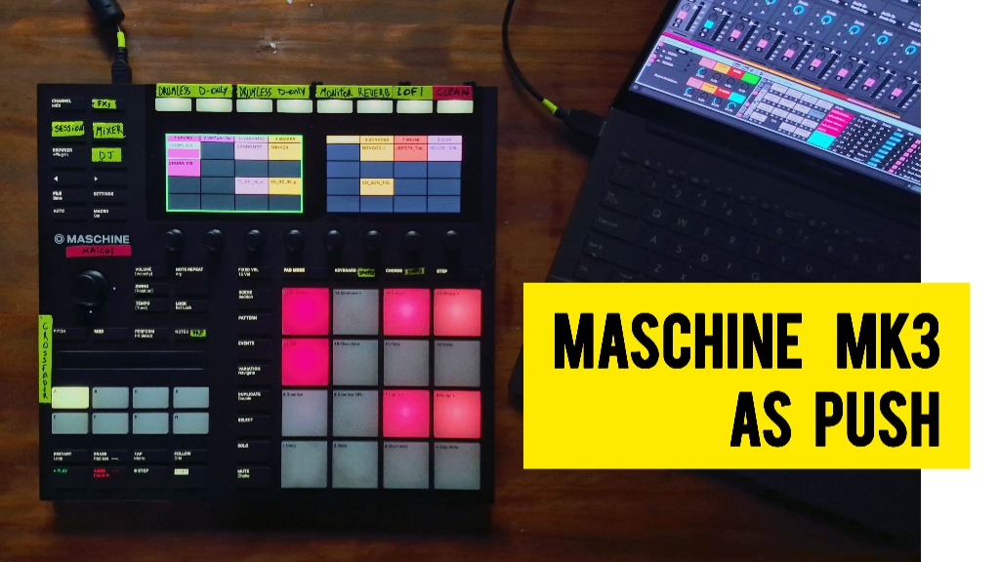

# 🖥️ Maschine MK3 Screen Driver

[](https://www.ableton.com)
[](https://www.native-instruments.com)
[](https://github.com/santiagojorda/maschine-mk3-as-ableton-push)
[](https://www.youtube.com/watch?v=ImqHw-zkiZQ&list=PLxk2dEOPjuEYO00P264yMStEUhukVkO1y)




Servidor y driver USB de alto rendimiento para **Native Instruments Maschine MK3**, diseñado para renderizar en tiempo real la interfaz gráfica nativa de **Ableton Live 12** en las dos pantallas LCD a color (480 × 272 c/u).

Forma parte del ecosistema **[maschine-mk3-as-ableton-push](https://github.com/santiagojorda/maschine-mk3-as-ableton-push)** y permite visualizar grilla de clips (Session), faders y vúmetros (Mixer), controles de dispositivos/plugins y el navegador de samples directamente en el hardware, transformando la Maschine en un controlador estilo **Ableton Push**.

🌐 **Sitio Web & Manual:** [santiagojorda.github.io/maschine-mk3-as-ableton-push](https://santiagojorda.github.io/maschine-mk3-as-ableton-push/)  
📦 **Descarga Directa (EXE):** [Última Release en GitHub](https://github.com/santiagojorda/maschine-mk3-as-ableton-push/releases/latest)  
🔗 **Repositorio Principal:** [maschine-mk3-as-ableton-push](https://github.com/santiagojorda/maschine-mk3-as-ableton-push)

---

## 📚 Documentación Técnica (`/docs`)

Toda la documentación técnica y manuales del proyecto se encuentran centralizados en la carpeta **[`/docs`](docs/README.md)**:

- 📖 **[Guía de Instalación y Restauración](docs/GUIA-INSTALACION.md):** Configuración paso a paso con Zadig, cómo iniciar el driver y procedimiento para restaurar el controlador original de Native Instruments.
- 🔬 **[Prototipo de Pantallas y Protocolo USB](docs/PROTOTIPO-PANTALLAS.md):** Especificación técnica del protocolo bulk USB (interfaz 5), formato RGB565 y telemetría UDP local.
- 📋 **[Plan de Arquitectura y Roadmap](docs/PLAN.md):** Plan del driver definitivo en Go, medición de latencias, lectura HID y compatibilidad futura con Linux / Push 3 standalone.

---

## ⚡ Cómo Funciona

1. **Comunicación con Ableton Live:**
   - El script MIDI de Ableton Live (`MaschineMK3AsPush`) transmite su estado en tiempo real vía socket **UDP local (puerto 9017)**.
   - Envía nombres de pistas, colores, clips activos, faders, vúmetros dinámicos, parámetros de plugins, árbol del browser y modos de encoder.

2. **Renderizado en Pantallas:**
   - El servidor procesa la telemetría y dibuja las vistas completas a **~20–30 FPS** en formato **RGB565**.
   - Envía los datos directamente por el endpoint USB Bulk (`0x04`) de la **interfaz 5** de la controladora (usando el driver WinUSB configurado en Zadig).
   - Para maximizar rendimiento y fluidez, calcula diferencias (dirty rects) y refresca la pantalla completa periódicamente.

3. **Modo Reposo inteligente (Standby):**
   - Al presionar <kbd>SHIFT</kbd> + <kbd>CHANNEL</kbd>, apaga botones y pads, y muestra un salvapantallas con el logotipo oficial para proteger las pantallas y evitar toques involuntarios.

---

## 🚀 Inicio Rápido y Scripts

Se incluyen scripts directos de un solo clic en la raíz:

| Script | Acción |
|---|---|
| **`iniciar_pantallas.bat`** | Inicia el driver en segundo plano (detecta automáticamente el ejecutable `MaschineMK3AsPush.exe` o el entorno virtual `.venv`). |
| **`detener_pantallas.bat`** | Detiene de forma limpia todos los procesos y deja las pantallas apagadas. |
| **`construir_exe.bat`** | Compila la aplicación autocontenida en `dist\MaschineMK3AsPush\MaschineMK3AsPush.exe` con PyInstaller. |

### Ejecutable Autocontenido (`MaschineMK3AsPush.exe`)

Podés descargar el paquete compilado listo para usar desde la sección de **[Releases](https://github.com/santiagojorda/maschine-mk3-as-ableton-push/releases)**:

```bash
# Iniciar el driver con supervisor automático
MaschineMK3AsPush.exe

# Detener el driver
MaschineMK3AsPush.exe --salir
```

- **Ruta de datos:** El registro (`pantallas.log`), la configuración (`config.json`) y el estado se almacenan en:  
  `%LOCALAPPDATA%\MaschineMK3AsPush\`
- **Inicio automático con Windows:** Colocá un acceso directo a `MaschineMK3AsPush.exe` dentro de `shell:startup` (<kbd>Win</kbd> + <kbd>R</kbd> → escribir `shell:startup`).

---

## 🛠️ Desarrollo con Python

Para modificar o depurar el código fuente con Python 3.12:

```bash
# 1. Crear entorno e instalar dependencias
python -m venv .venv
.venv\Scripts\pip install -r requirements.txt

# 2. Iniciar el supervisor en consola
.venv\Scripts\python prototipo\supervisor.py
```

---

## 🔄 Volver al Driver de Fábrica de Native Instruments

Si querés restaurar el driver original de NI:
1. Abrí el **Administrador de Dispositivos** (`devmgmt.msc`).
2. En *Dispositivos de bus serie universal*, buscá **`Maschine MK3 BD (Interface 5)`**.
3. Clic derecho → **Desinstalar el dispositivo** (marcando la casilla de eliminar el controlador).
4. Desconectá y reconectá el cable USB: Windows reinstalará automáticamente el driver original oficial de Native Instruments (`nimc3usb.inf`).

Para más detalles, consultá la **[Guía de Instalación y Restauración](docs/GUIA-INSTALACION.md)**.

---

## 👤 Creador y Créditos

- **Desarrollo y concepto:** Santiago Jorda (Maicol)  
  - 📺 [Maicol Session en YouTube](https://www.youtube.com/watch?v=ImqHw-zkiZQ&list=PLxk2dEOPjuEYO00P264yMStEUhukVkO1y)  
  - 📸 Instagram: [@santiagojorda](http://instagram.com/santiagojorda)
- **Protocolo de pantallas y comunicación USB:** Basado en especificaciones de [ni-controllers-lib](https://github.com/asutherland/ni-controllers-lib).

[](https://www.youtube.com/watch?v=ImqHw-zkiZQ&list=PLxk2dEOPjuEYO00P264yMStEUhukVkO1y)

---

`#maschine-mk3` `#ableton-live` `#ableton-push` `#usb-driver` `#midi-controller` `#winusb` `#display-driver` `#native-instruments`

